## Cancer Risk Factors - Machine Learning Classification

###### Risk Factors Graph
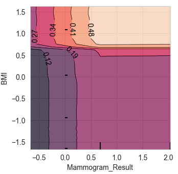

### Overview
In this project I used machine learning techniques to classify risk factors for breast cancer.  I found a user friendly dataset on Kaggle that only required a little cleaning.  I performed multiple machine learning classification procedures, determined the best model, and graphed results to interpret the model, using Scikit Learn, pandas, numpy, and matplotlib packages in Python.  The classification methods I used were K-Nearest Neighbors, Support Vector, and Random Forest.

### Data Sets Used
I used a synthetic dataset from Kaggle - [Breast Cancer Prediction Dataset](https://www.kaggle.com/datasets/mobeenfatimah/breast-cancer-prediction-dataset-10000-patient).  The dataset has demographic and health measures that can be used to predict whether a patient has breast cancer and the stage of the cancer.  The dataset was created for research purposes.

_From the source page:_

>Overview:  
>This dataset contains 10,000 synthetic patient records designed for machine learning, data science, and educational purposes.
>It includes demographic information, lifestyle factors, medical history, diagnostic findings, and a binary target variable indicating breast cancer diagnosis.
>
>
>Disclaimer:  
>This dataset is synthetically generated and intended solely for educational, research, and machine learning practice.
>It does not contain real patient information and must not be used for clinical diagnosis or medical decision-making.


### Data Preparation
I performed a few key steps to prepare the data for modeling - encoding categorical data, imputing values for missing data, and scaling the features.

Several fields contained categorical data - gender, family history of breast cancer, smoking indicator, alcohol consumption indicator, etc.  The classification models require numerical variables in order to run.  I used the ordinal encoder from the Scikit Learn and mapped unknown or missing values to -1.  The categorical variables were transformed into ordinal integers ranging from -1 to 5.  Most encoded variables had only two categories and no missing values, so they were encoded as 0's and 1's.

```
from sklearn.preprocessing import OrdinalEncoder

Gender_Order =  ['Male', 'Female']
Family_History_Order =  ['No', 'Yes']
Smoking_Order = ['No', 'Yes']
Alcohol_Consumption_Order =  ['No', 'Yes']
Physical_Activity_Order =  ['Low', 'Moderate', 'High']
Hormone_Therapy_Order =  ['No', 'Yes']
Menopause_Status_Order = ['Pre', 'Post']
Genetic_Mutation_Order = ['Negative', 'Positive']
Lymph_Node_Involvement_Order = ['No', 'Yes']
Mammogram_Result_Order = ['Normal', 'Suspicious', 'Abnormal']
Biopsy_Result_Order = ['Benign', 'Malignant']
Cancer_Stage_Order = ['No Cancer', 'Stage I', 'Stage II', 'Stage III', 'Stage IV']
Diabetes_Order = ['No', 'Yes']
Breastfeeding_History_Order = ['No', 'Yes', 'Not Applicable']

encoder = OrdinalEncoder(categories=[Gender_Order,Family_History_Order,Smoking_Order,Alcohol_Consumption_Order,
Physical_Activity_Order,Hormone_Therapy_Order,Menopause_Status_Order,Genetic_Mutation_Order,
Lymph_Node_Involvement_Order,Mammogram_Result_Order,Biopsy_Result_Order,Cancer_Stage_Order,
Diabetes_Order,Breastfeeding_History_Order],handle_unknown='use_encoded_value',unknown_value=-1,encoded_missing_value=-1)

df_bc_pred[['Gender','Family_History','Smoking','Alcohol_Consumption',
'Physical_Activity','Hormone_Therapy','Menopause_Status','Genetic_Mutation',
'Lymph_Node_Involvement','Mammogram_Result','Biopsy_Result','Cancer_Stage',
'Diabetes','Breastfeeding_History']] = encoder.fit_transform(df_bc_pred[['Gender','Family_History','Smoking','Alcohol_Consumption',
'Physical_Activity','Hormone_Therapy','Menopause_Status','Genetic_Mutation',
'Lymph_Node_Involvement','Mammogram_Result','Biopsy_Result','Cancer_Stage',
'Diabetes','Breastfeeding_History']])
```

The BMI (body mass index) and tumor size variables were missing some values so I imputed the average from each field.  The K-Nearest Neighbors and Support Vector models required imputed values in order to run.  I tried the Random Forest model both with and without imputed values and got similar results.

```
if mean_fill == 'Fill':
    df_bc_pred['BMI'] = df_bc_pred['BMI'].fillna(df_bc_pred['BMI'].mean())
    df_bc_pred['Tumor_Size_cm'] = df_bc_pred['Tumor_Size_cm'].fillna(df_bc_pred['Tumor_Size_cm'].mean())
```

After splitting the dataset into training and test sets, I scaled the features using the Scikit Learn standard scaler.  There are a few different reasons why feature scaling matters.  One of the big reasons is that it prevents one feature from dominating the others because of larger values.  The feature of BMI generally has values in the 20's, while Age can range from 1 to 100.  Gender, family history of breast cancer, smoking indicator, and other categorical variables were encoded to integers near 0, so BMI and Age would have had disproportionate influence in the model if all the features were not scaled.

The original dataset contained 19 risk factor variables, a patient identification field, biopsy result, cancer stage, and cancer indicator fields.  The biopsy result and cancer stage fields contained categories that indicated cancer directly, so I left them out of my models.  


### Model Results
I fit classification models of K-Nearest Neighbors, Support Vector, and Random Forest.  I used the 19 risk factor variables as the X variables, and the cancer indicator variable as the Y variable.  The dataset had 10,000 rows.  I split it 75%/25% between training and test data.

```
from sklearn.model_selection import train_test_split
from sklearn.preprocessing import StandardScaler

if orig_variables == 'Original':
    X = pd.DataFrame(df_bc_pred[['Age',
     'Gender',
     'BMI',
     'Family_History',
     'Smoking',
     'Alcohol_Consumption',
     'Physical_Activity',
     'Hormone_Therapy',
     'Menopause_Status',
     'Genetic_Mutation',
     'Tumor_Size_cm',
     'Lymph_Node_Involvement',
     'Mammogram_Result',
     'Blood_Pressure',
     'Cholesterol',
     'Diabetes',
     'Exercise_Days_Per_Week',
     'Breastfeeding_History',
     'Annual_Income_USD']])
    y = df_bc_pred[['Cancer']]

X_train, X_test, y_train, y_test = train_test_split(X, y, test_size = 0.25, random_state = 0)

sc = StandardScaler().set_output(transform="pandas")
X_train = sc.fit_transform(X_train)
X_test = sc.transform(X_test)

y_train = y_train.values.ravel()
y_test = y_test.values.ravel()

if model_type == 'RandomForest':
    from sklearn.ensemble import RandomForestClassifier
    classifier = RandomForestClassifier(n_estimators = 100, criterion = 'entropy', random_state = 0)
    classifier.fit(X_train, y_train)

if model_type == 'KNN':
    from sklearn.neighbors import KNeighborsClassifier
    classifier = KNeighborsClassifier(n_neighbors = 12, metric = 'minkowski', p = 2)
    classifier.fit(X_train, y_train)

if model_type == 'SVC':
    from sklearn.svm import SVC
    classifier = SVC(kernel = 'rbf', random_state = 0)
    # classifier = SVC(kernel = 'poly', random_state = 0)
    # classifier = SVC(kernel = 'sigmoid', random_state = 0)
    classifier.fit(X_train, y_train)
```

With the K-Nearest Neighbors model I got a best model accuracy near 88%, when using 5, 7, 9, and 11 neighbors, and lower accuracy with other numbers of neighbors.  My best result for the Support Vector Classification model was 93% accuracy with the rbf kernel.  I got 92% accuracy with the polynomial kernel, and 88% accuracy with the sigmoid kernel.  When fitting the Random Forest model, I got 95% accuracy with 10 trees and 98% accuracy with 100 trees.  The Random Forest model proved superior for this dataset.

After fitting the initial Random Forest models, I removed some variables with low feature importances and reran the model.  I got very similar results to the initial model, just slightly improved.  Tumor size, BMI, Age, and Mammogram Result were the features with greatest importance.

```
predictions = classifier.predict(X_test)
accuracy = accuracy_score(y_test, predictions)

print(f"Model Accuracy: {accuracy * 100:.2f}%")
```
> Model Accuracy: 98.84%

```
from sklearn.metrics import confusion_matrix

y_pred = classifier.predict(X_test)
cm = confusion_matrix(y_test, y_pred)
print(cm)
```
>[[2017    1]
>
> [  28  454]]
>
> 1 False Positive, 28 False Negatives, 2017 True Negatives, 454 True Positives
>

```
                   Feature  Importance
6            Tumor_Size_cm    0.130338
1                      BMI    0.123999
0                      Age    0.123712
8         Mammogram_Result    0.099698
3                  Smoking    0.092754
2           Family_History    0.090424
7   Lymph_Node_Involvement    0.082802
5         Genetic_Mutation    0.079821
13       Annual_Income_USD    0.043617
10             Cholesterol    0.042300
9           Blood_Pressure    0.039077
11  Exercise_Days_Per_Week    0.023965
4        Physical_Activity    0.015554
12   Breastfeeding_History    0.011939
```


### Visualizing the Results

I created partial density and ICE plots to evaluate how each feature affected the incidence of cancer.  Partial dependence plots are explained on the Scikit Learn website - [Partial Dependence Plots Scikit-Learn](https://scikit-learn.org/stable/modules/partial_dependence.html)
>Partial dependence plots (PDP) show the dependence between the target response and a set of input features of interest, marginalizing over the values of all other input features (the ‘complement’ features). **Intuitively, we can interpret the partial dependence as the expected target response as a function of the input features of interest.**

```
from sklearn.inspection import PartialDependenceDisplay

features_to_plot = ["Age","Tumor_Size_cm",("Age", "Tumor_Size_cm")]
# Plot the partial dependence
fig, ax = plt.subplots(figsize=(18, 6))
display = PartialDependenceDisplay.from_estimator(
    classifier,
    X_train,
    features=features_to_plot,
    grid_resolution=50,  # Number of points to evaluate along each axis
    ax=ax,
)
plt.show()
```
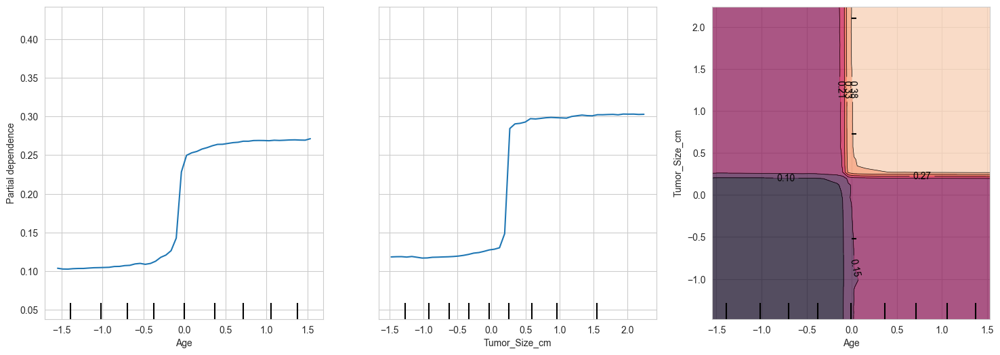

The Age, Tumor Size, and Tumor Size vs Age partial dependence plots above show that there's an increased risk of cancer at certain ages and tumor sizes.  The data is scaled with a mean of 0 and each unit equal to 1 standard deviation.  The risk of cancer increases right at the mean of Age, which is 52, as can be seen below in the Means and Variances model stats.  For Tumor Size, there's a sharp increase in cancer risk around 0.25 standard deviations above the mean.

The 2D partial density plot on the right side shows the combined effect of Age and Tumor Size on cancer risk.  The partial dependence increases from 0.10 to above 0.38 for greater values of Age and Tumor Size.

```
print("Means:", sc.mean_)
print("Variances:", sc.var_)
```
> Means:
>
> [5.21232000e+01, 2.70290052e+01, 3.03066667e-01, 2.54933333e-01,
>
> 8.99066667e-01, 1.48666667e-01, 2.63107035e+00, 2.02933333e-01,
>
> 4.96266667e-01, 1.34577600e+02, 2.13878400e+02, 3.55760000e+00,
>
> 8.55866667e-01, 8.23092333e+04]
>
> Variances:
>
> [3.54022955e+02, 1.98689073e+01, 2.11217262e-01, 1.89942329e-01,
>
> 6.38479129e-01, 1.26564889e-01, 2.52307180e+00, 1.61751396e-01,
>
> 5.49186062e-01, 6.85070112e+02, 2.42216681e+03, 5.23441557e+00,
>
> 5.30025582e-01, 1.52589488e+09]

> Variable Order:
> 
>     'Age', 'BMI', 'Family_History', 'Smoking',
> 
>     'Physical_Activity', 'Genetic_Mutation', 'Tumor_Size_cm', 'Lymph_Node_Involvement',
> 
>     'Mammogram_Result', 'Blood_Pressure', 'Cholesterol', 'Exercise_Days_Per_Week',
>
>     'Breastfeeding_History', 'Annual_Income_USD'

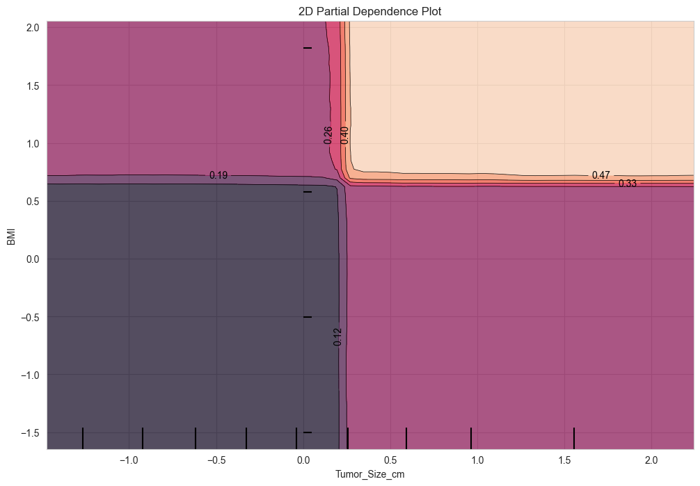

In the above 2D partial dependence plot, the viewer can see the partial dependence of cancer risk increases from 0.12 to above 0.47 when both BMI and Tumor Size are elevated.  There's an increased risk at 0.7 standard deviations above the BMI mean, or around a BMI of 30.  


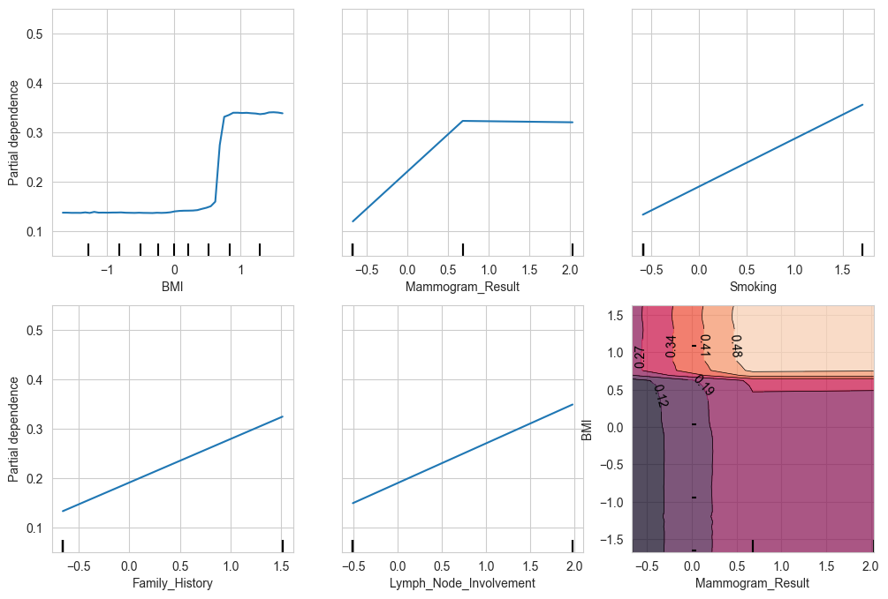

In the partial dependence plot above, viewers can see a comparison between BMI, a continuous variable of high importance, and categorical variables of moderate to high importance.  In the mammogram result graph, 0.5 standard deviations below the mean corresponds to a mammogram  of Normal.  A value of 0.7 standard deviations above the mean corresponds to a result of Suspicious.  A value of 2 standard deviations above the mean corresponds to a result of Abnormal.

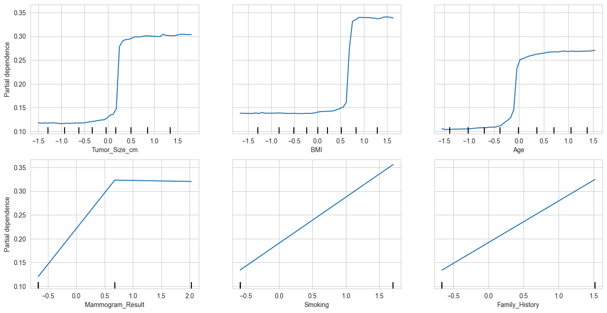

The features with the greatest importance in the Random Forest model are shown above.  Each feature increases the partial dependence of cancer risk significantly.

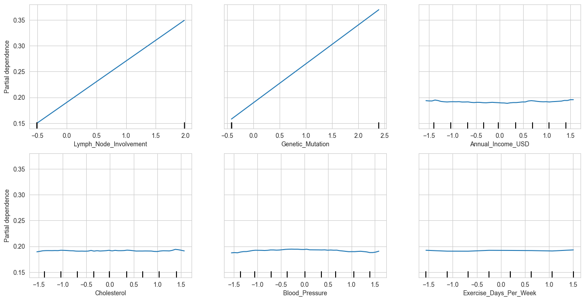

Features with moderate to low importance are shown above.  The Lymph Node and Genetic Mutation plots show a big increase in cancer risk with an increase in feature value, while the rest of the variables have little influence on cancer risk.

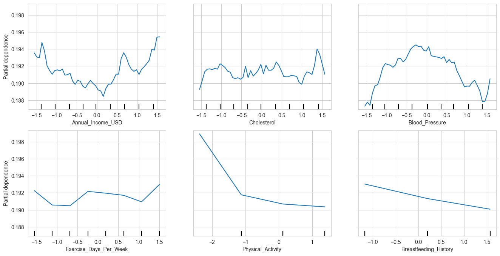

When features of low importance are graphed together, viewers can see the variation in partial dependence of cancer risk, but the scale is very small.  The variation in cancer risk from the low importance features seems pretty random.

#### ICE Plots
ICE plots are explained on the Scikit Learn website - [ICE Plots Scikit-Learn](https://scikit-learn.org/stable/modules/partial_dependence.html)
>Similar to a PDP, an individual conditional expectation (ICE) plot shows the dependence between the target function and an input feature of interest. However, unlike a PDP, which shows the average effect of the input feature, **an ICE plot visualizes the dependence of the prediction on a feature for _each sample_ separately with one line per sample... When interactions are present the ICE plot will provide many more insights.**

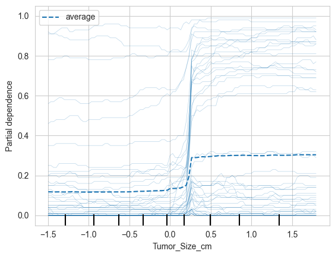

ICE plots can show interactions with other variables, but don't explain which other variables are involved.  For example, in the Tumor Size ICE plot, the viewer can see a gap between lines near the top of the graph and lines near the bottom.  The gap is especially pronounced for tumors with size greater than 0.3 standard deviations above the mean.  There are other variable(s) that either make cancer much more likely, or make cancer unlikely when the tumor size is above that 0.3 SD threshold.


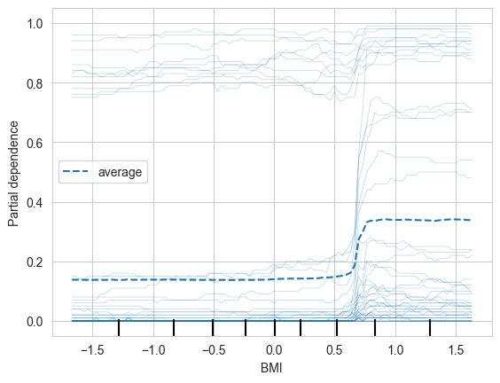


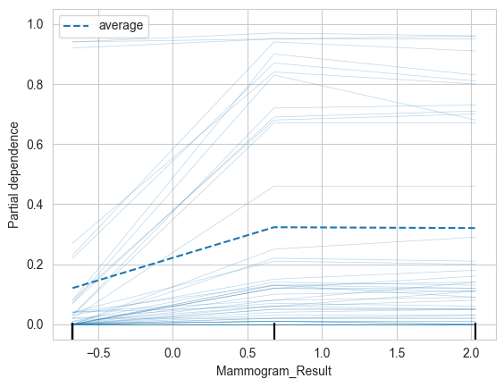

The same situation is present in the BMI and Mammogram Result graphs - where there is a gap near the average partial dependence.  There are more lines below the gap, indicating cancer is unlikely, but there are also lines above the gap that show a significant increase in cancer risk.  Those gaps show an interaction with other variables, which make cancer either significantly more likely, or less likely.  In the BMI graph, there's an interaction that causes cancer to be more likely for some patients regardless of BMI - there are lines near the top of the graph that are fairly flat and only slightly affected by BMI.


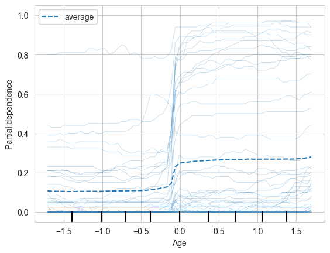

In the Age ICE plot we see the same interaction effect, but it is less pronounced.

From the 2D partial dependence plots above, it's evident that the interactions must involve some of the features with higher importance.  In the 2D plots, there's an increased risk of cancer when Tumor Size, BMI, Age, and Mammogram Result are elevated, but when any of those variables are low, the partial dependence cancer risk remains fairly low, below ~0.25.  We can conclude the features with highest importance - Tumor Size, BMI, Age, and Mammogram Result - interact to significantly increase or reduce the risk of cancer.

### Concluding Remarks
I tried multiple methods and was able to create an accurate classifier with the Random Forest machine learning model.  In the partial density and ICE plots, it was evident that interactions between risk factors had the potential to increase cancer risk significantly.  The dataset I used was synthetic and had a major flaw.  Gender was the least important feature, according to the results of the Random Forest model with all variables included, but gender is the top risk factor for breast cancer.  According to the World Health Organization - [WHO Breast Cancer](https://www.who.int/news-room/fact-sheets/detail/breast-cancer), only 0.5-1% of breast cancers occur in men.  The other top risk factors make sense, but it's hard to know which factors increase cancer risk the most, since the dataset was synthetic.


### Sources:
Fatima, Mobeen (2026).  Breast Cancer Prediction Dataset | 10,000 Patient.  [breast_cancer_prediction.csv].  Kaggle.  https://www.kaggle.com/datasets/mobeenfatimah/breast-cancer-prediction-dataset-10000-patient.  License: CC BY-NC-SA 4.0


### Disclaimer:
I used AI to research and produce some of the code used in my statistical models.  I did not use AI to edit or write any of the analysis.


[back](./)
