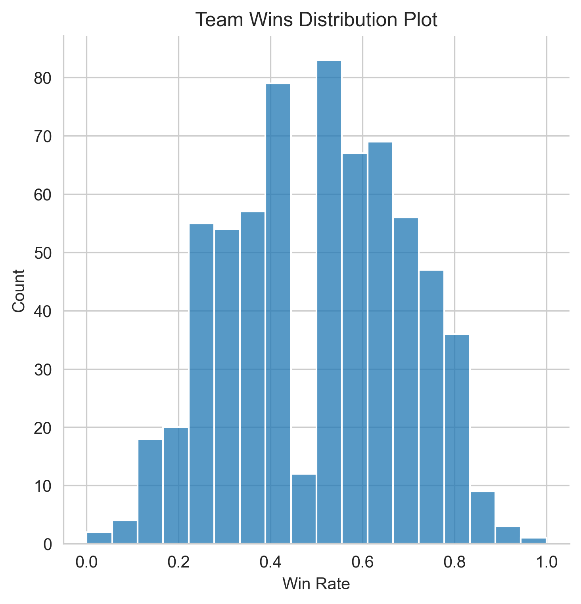
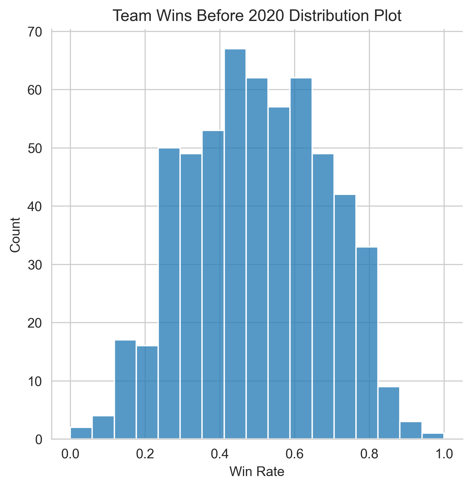
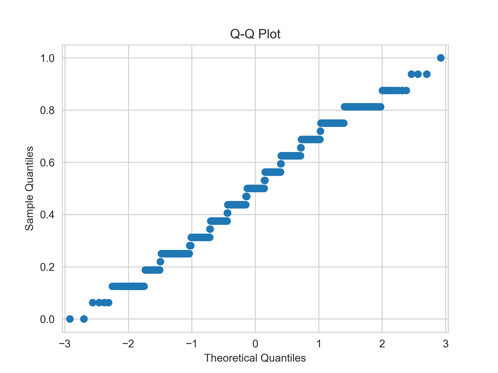
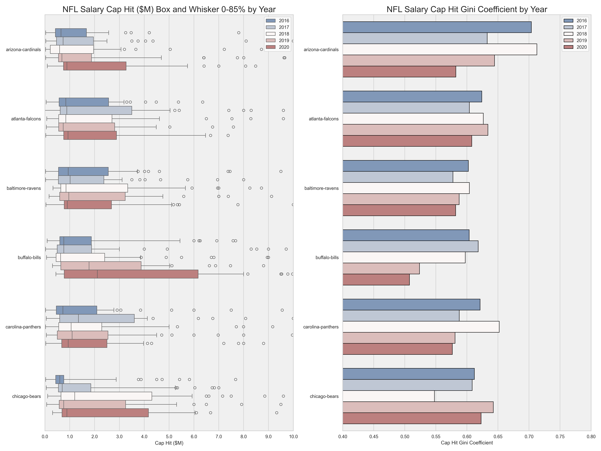

### Overview
I wanted to practice some machine learning techniques.  I spent a lot of time in my previous job working on imaging and mammography data, so I thought a user friendly dataset on Kaggle with breast cancer risk factors would be a great source.  I performed multiple machine learning classification procedures, found the best model, and graphed results to interpret the model, using Scikit Learn, pandas, numpy, and matplotlib packages in Python.  The classification methods I used were K-Nearest Neighbors, Support Vector, and Random Forest.

### Data Sets Used
I used a synthetic dataset from Kaggle - [Breast Cancer Prediction Dataset](https://www.kaggle.com/datasets/mobeenfatimah/breast-cancer-prediction-dataset-10000-patient).  The dataset has demographic and health factor measures that can be used to predict whether a patient has breast cancer and the stage of the cancer.  The dataset was created for research purposes.

_From the source page:_

>Overview:  
>This dataset contains 10,000 synthetic patient records designed for machine learning, data science, and educational purposes.
>It includes demographic information, lifestyle factors, medical history, diagnostic findings, and a binary target variable indicating breast cancer diagnosis.
>
>
>Disclaimer:  
>This dataset is synthetically generated and intended solely for educational, research, and machine learning practice.
>It does not contain real patient information and must not be used for clinical diagnosis or medical decision-making.


### Data Preparation
I performed a few key steps to prepare the data for modeling - encoding categorical data, imputing values for missing data, and scaling the features.

Several fields contained categorical data - gender, family history of breast cancer, smoking indicator, alcohol consumption indicator, etc.  The classification models require numerical variables to run.  I used the ordinal encoder from the Scikit Learn and mapped unknown or missing values to -1, so the categorical variables were transformed into ordinal integers ranging from -1 to 5.  Most encoded variables had only two categories and no missing values, so they were encoded as 0's and 1's.

The BMI (body mass index) and tumor size variables were missing some values so I imputed the average from each field.  The K-Nearest Neighbors and Support Vector models required imputed values in order to run.  I tried the Random Forest model both with and without imputed values and got similar results.

After splitting the dataset into training and test sets I scaled the features using the Scikit Learn standard scaler.  There are a few different reasons why feature scaling matters.  One of the big reasons is that it prevents one feature from dominating the others because of larger values.  The feature of BMI generally has values in the 20's, while Age can range from 1 to 100.  Gender, family history of breast cancer, smoking indicator, and other categorical variables were encoded to integers near 0, so BMI and Age would have had disproportionate influence in the model if all the features were not scaled.

The original dataset contained 19 risk factor variables, a patient identification field, biopsy result, cancer stage, and cancer indicator fields.  The biopsy result and cancer stage fields contained categories that indicated cancer directly, so I left them out of my models.  


### Data Preparation
I fit classification models of K-Nearest Neighbors, Support Vector, and Random Forest.  I used the 19 risk factor variables as the X variables, and the cancer indicator variable as the Y variable.  The dataset had 10,000 rows.  I split it 75%/25% between training and testing data.

With the K-Nearest Neighbors model I got a best model accuracy near 88%, when using 5, 7, 9, and 11 neighbors, and lower accuracy with other numbers of neighbors.  My best result for the Support Vector Classification model was 93% accuracy with the rbf kernel.  I got 92% accuracy with the polynomial kernel, and 88% accuracy with the sigmoid kernel.  When fitting the Random Forest model, I got 95% accuracy with 10 trees and 98% accuracy with 100 trees.  The Random Forest model proved superior for this dataset.

After fitting the initial Random Forest models, I removed some variables with low feature importances and reran the model.  I got very similar results to the initial model, just slightly improved.  Tumor size, BMI, Age, and Mammogram Result were the features with greatest importance.

```
                   Feature  Importance
6            Tumor_Size_cm    0.130338
1                      BMI    0.123999
0                      Age    0.123712
8         Mammogram_Result    0.099698
3                  Smoking    0.092754
2           Family_History    0.090424
7   Lymph_Node_Involvement    0.082802
5         Genetic_Mutation    0.079821
13       Annual_Income_USD    0.043617
10             Cholesterol    0.042300
9           Blood_Pressure    0.039077
11  Exercise_Days_Per_Week    0.023965
4        Physical_Activity    0.015554
12   Breastfeeding_History    0.011939
```


Describe model fitting and results
Fit training models using sklearn classification models
Determined model accuracy using test set
	- Predicted values using x_test, compared to y_test data
	- Created confusion matrix
For random forest model, refined fields to include and reran classification
	- Explain reasons to remove fields
	- Similar results as before


### Tests for Normality
I began my regression by testing the win-loss percentage variable for normality.  The Q-Q Plot below seems to indicate a normal distribution, but the values are stepped, because teams play 16 games a season (17 starting in 2020).  There are occasionally ties, but those are rare.  There are a limited number of win-loss percentages possible.  The low win rate in the middle of the graph comes from the 2020-2023 seasons when teams started playing an extra game each year.  Since there are fewer seasons with 17 games, the 8/17 win rate of 0.47 was less common than the 7/16 win rate of 0.4375, and than other bucketed win rates.




When I removed the 2020-2023 years, the distribution plot appeared more normal, and the Q-Q plot appeared more stepped.  




I performed Sharpiro-Wilk, scipy.stats normal test, and Anderson-Darling tests for normality both including and excluding the 2020-2023 seasons.  Each test determined the data is not normally distributed, but the Shapiro-Wilk test statistic of 0.985 with the 2020-2023 seasons excluded was very close to 1, and a test statistic near 1 indicates a normal distribution.  The data is stepped, so it is not truly normally distributed, but it's close enough to a normal distribution that I will assume normality and proceed with the regression.

### Fields Added
I calculated the gini coefficient by team and season as well as sum of salary cap hit and cap percentage.  Then I added the average of the current and past season gini coefficient.  Here's a sample of the data:
  
```
                      team  season  cap_hit_sum  cap_percent_sum
0        arizona-cardinals    2014     99264014            73.03
1        arizona-cardinals    2015    121979201            82.12
2        arizona-cardinals    2016    111290277            70.00
3        arizona-cardinals    2017    104474970            60.79
4        arizona-cardinals    2018    107921249            60.36

                      team  season  cap_hit_gini_coef  avg_gini_coef_2_years
0        arizona-cardinals    2014           0.597684                    NaN
1        arizona-cardinals    2015           0.643391               0.620537
2        arizona-cardinals    2016           0.703863               0.673627
3        arizona-cardinals    2017           0.632705               0.668284
4        arizona-cardinals    2018           0.712755               0.672730  
```  
  
I graphed box and whisker plots of the salary cap hit data alongside bar charts of the gini coefficient data.  Note the gini coefficient graph x-axis has a range of (0.4, 0.8) - the gini coefficients do not vary as much as they appear in the graph.
  


  
Here's a link to the same salary cap hit and gini coefficient graphs with all teams included and a link to a Power BI report to explore salaries further.  In the Power BI report you can view individual player salaries by team for each season.

[Gini Coefficient Graphs](https://efruin-git.github.io/NFL-Salaries-Box-Whisker-Gini-Coef.html)

[NFL Salaries and Gini Coefficient Power BI Report](https://efruin-git.github.io/NFL_Salaries_and_Gini_Coefficient_PowerBI_Report.html)

In the cap hit and gini coefficient graphs, you'll notice greater median salaries correspond to lower gini coefficients (less salary inequality).  Team salary caps generally increase each year, so a small increase in median cap hit may not translate to a lower gini coefficient that year.  A wider interquartile range or wider whiskers will not necessarily change the gini coefficient.

### Salary Cap Background
More context on the salary cap may be helpful to understand the data.  The league salary cap applies to each team and increases each year, but salary caps can very by team based on factors including unique player contracts, carry-over cap space from prior years, and dead cap space from releasing players with guaranteed money.  My data analysis uses salary cap hit and salary cap percentage from players on each team.  Dead cap space would prevent a team from using all their cap space, and total cap hit percentage would be lower for that team.  

Here's more info from Pro Football Network [Salary Cap](https://www.profootballnetwork.com/nfl-salary-cap-space-by-team):
>In 2025, the league set the base salary cap for all teams at $279.2 million. Each team then adds on any rolled-over money from the previous season. In essence, this is money that they did not spend against the previous cap. Some further adjustments based on contractual elements are then made to achieve a final number for each team.
>
>Per-game bonuses and incentives also count against the salary cap. How much they count against the cap in a single year is dependent on various factors. Any incentives considered “likely to be earned” count against the cap in that year, and if the player does not reach the threshold, the team pays back the incentives in the form of cap credits as part of cap adjustments.


### Sources:
Fatima, Mobeen (2026).  Breast Cancer Prediction Dataset | 10,000 Patient.  [breast_cancer_prediction.csv].  Kaggle.  https://www.kaggle.com/datasets/mobeenfatimah/breast-cancer-prediction-dataset-10000-patient.  License: CC BY-NC-SA 4.0


### Disclaimer:
I used AI to research and produce some of the code used in my statistical models.  I did not use AI to edit or write any of the analysis.


[back](./)
