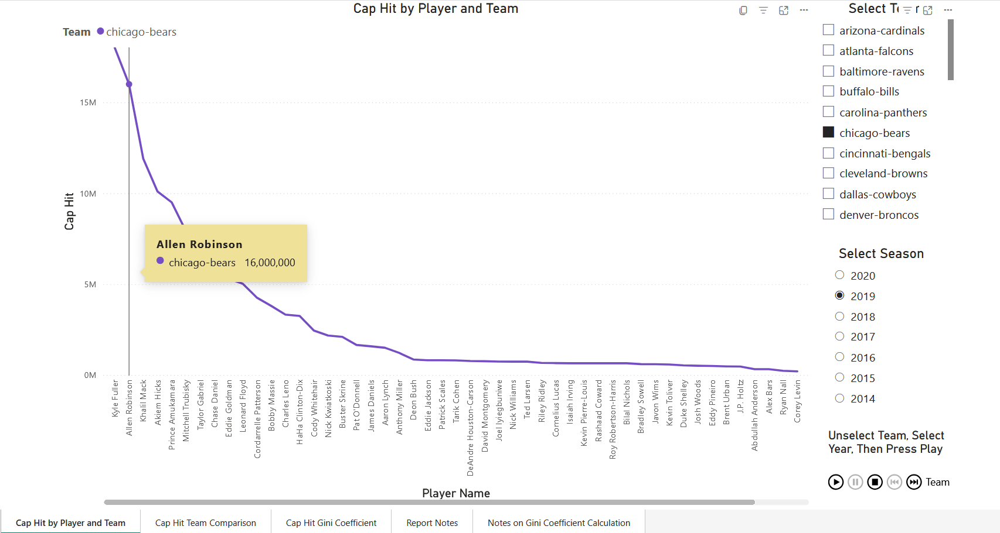

[Link to Power BI Report - Global Health and Inequality](https://app.powerbi.com/reportEmbed?reportId=672903bb-96fe-4342-9ed5-9c8da6129d6f&autoAuth=true&ctid=87f457b7-df9f-4c5a-a1fa-7eb5150a5541)
 

The Power BI report may require viewers to login to their Microsoft or Power BI account.  I've provided screenshots of each tab so viewers can review the dashboard without having to login.  The dashboard has additional interactive features.  
 

  
 
     
