[Link to Power BI Report - Global Health and Inequality](https://app.powerbi.com/reportEmbed?reportId=672903bb-96fe-4342-9ed5-9c8da6129d6f&autoAuth=true&ctid=87f457b7-df9f-4c5a-a1fa-7eb5150a5541)
 

The Power BI report may require viewers to login to their Microsoft or Power BI account.  I've provided screenshots of each tab so viewers can review the dashboard without having to login.  The dashboard has additional interactive features.  
 
I plan to add more analysis to this page.
 

### Dashboard Overview

#### Data Sources
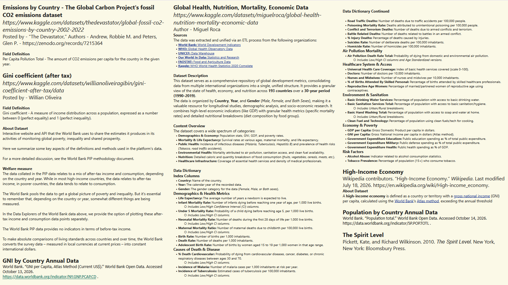  
 
     

#### Notes and Analysis
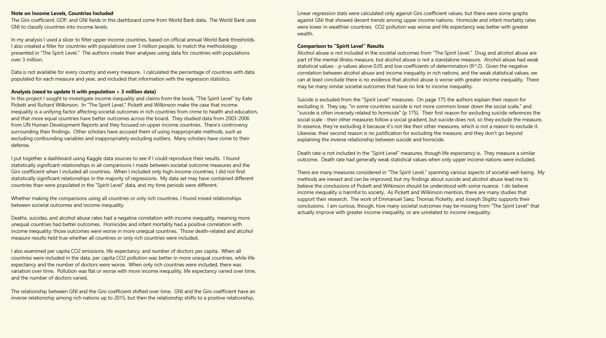  
 
     

### Societal Outcomes tab
#### Users can choose which parameters to view, which year, and which income levels.
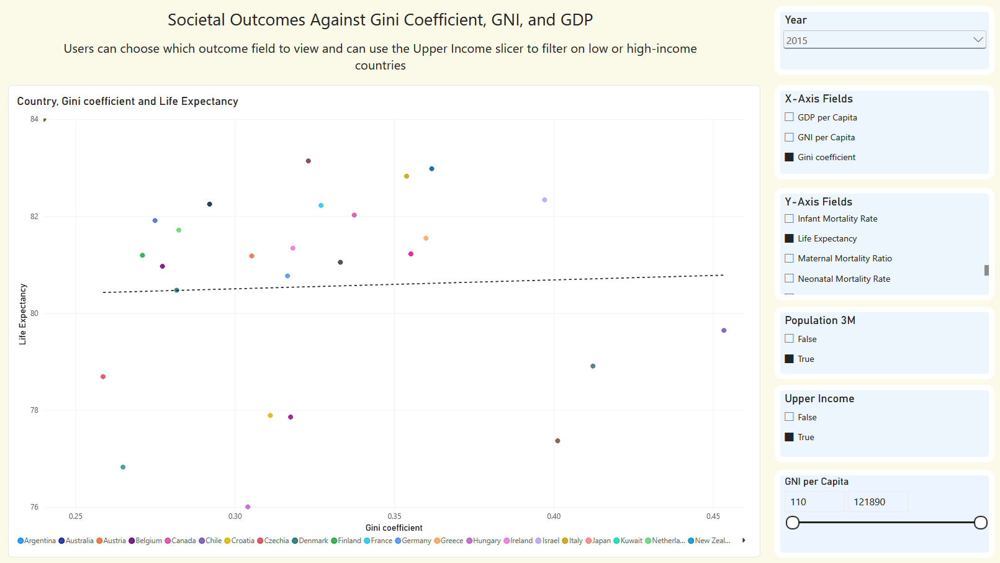  
 
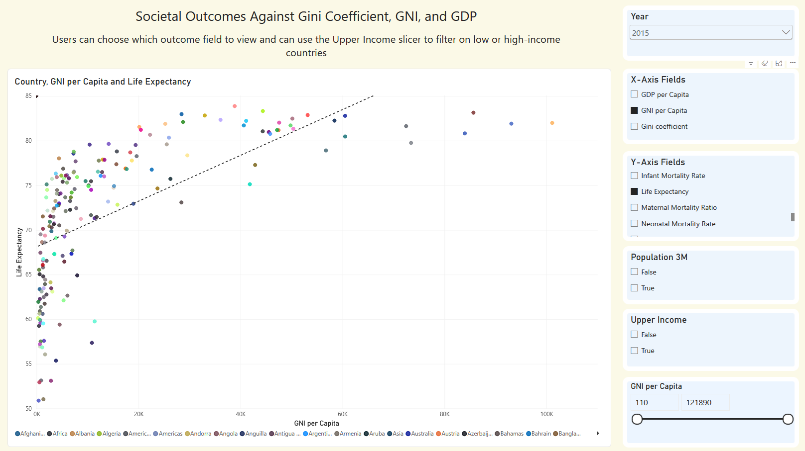  
     
 

### Statistical Results for All Countries
When all countries were included, the p-values for measures on the next two tabs (Death and Alcohol, Pollution and Life Expectancy) were under 0.06; only two measures had a p-value greater than 0.06 between 2003 and 2017, and those measures only had high p-values for 1 year each.
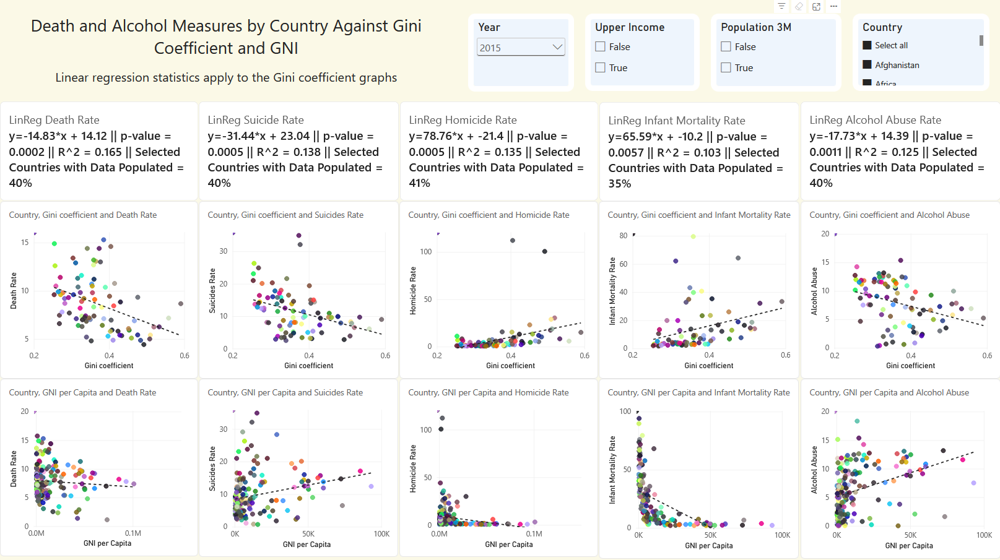  
 
     

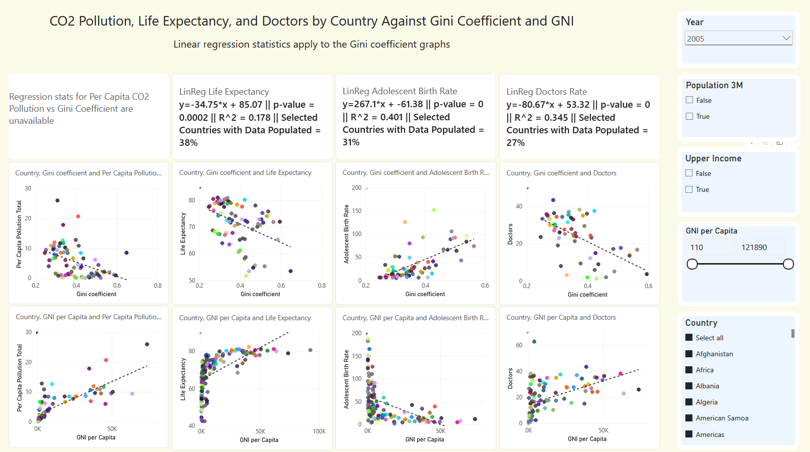  
 
     

### Gini Coefficient vs GNI
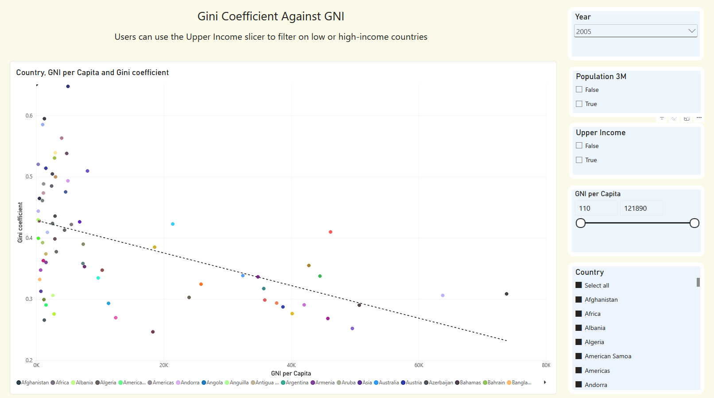  
 
     

### Relationships between measures and the gini coefficient change with income levels
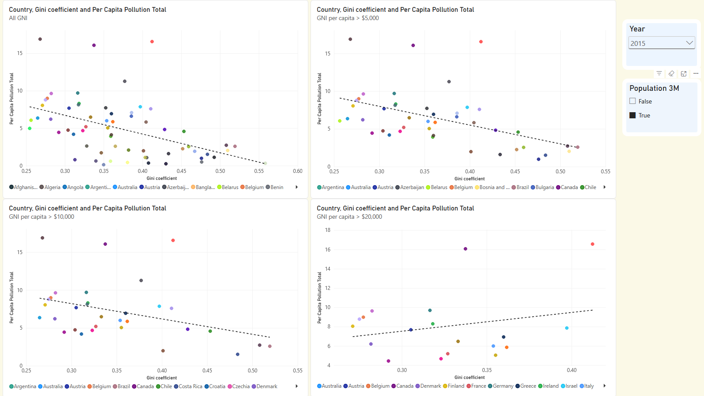  
 
     

### Statistical Results for Upper Income Countries
In "The Spirit Level," the authors focus on upper income countries with over 3 million people.  When only those countries are included, p-values are not consistent from year to year.  Most measures had high p-values for at least a few years.  Alcohol Abuse and Adolescent Birth Rate were the only exceptions.  Data for the alcohol abuse measure was only available every 5 years.  For 2005, the p-value was 0.062.  For 2010 and 2015, the p-values were both 0.02.  So alcohol abuse had decent p-values for all years with data.  Adolescent birth rate had the most consistent and strong p-values.  The p-values for adolescent birth rate (births among women aged 15-19) were 0.05 or below every year.
 
#### 
Homicide, Infant Mortality, Life Expectancy, and Teenage Birth Rate (births among women aged 15-19) are measures included in the "Spirit Level" analysis that I also included in my dashboard.  I only found consistent, statistically significant results for Teenage Birth Rate.  The original study in "The Spirit Level" uses data from the years 1998-2004 for most of the measures.  Homicide data comes from the years 1990-2000.    

### Death and Alcohol Tab
 
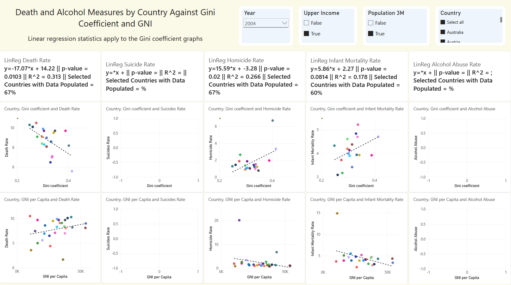  
 
     
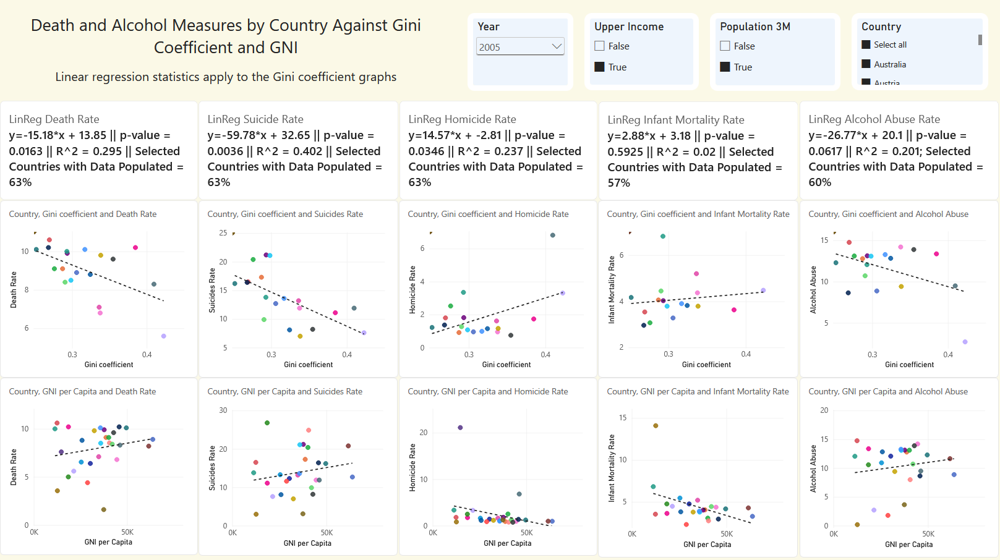  
 
     
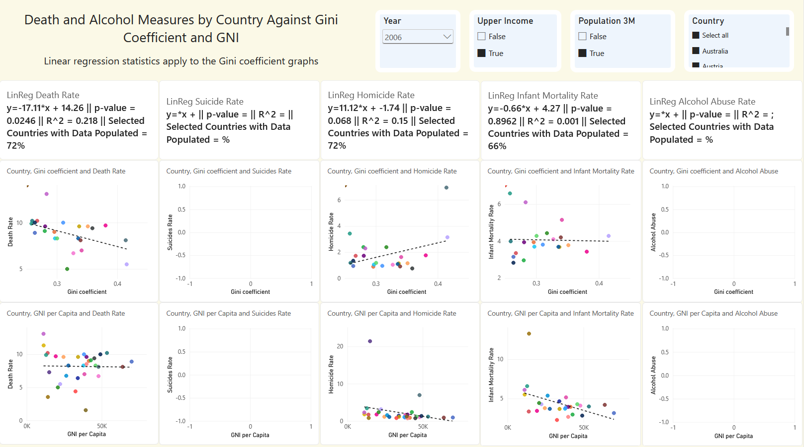  
 
     
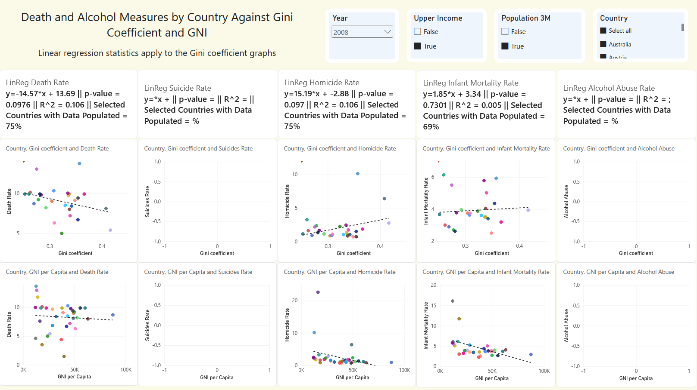  
 
     
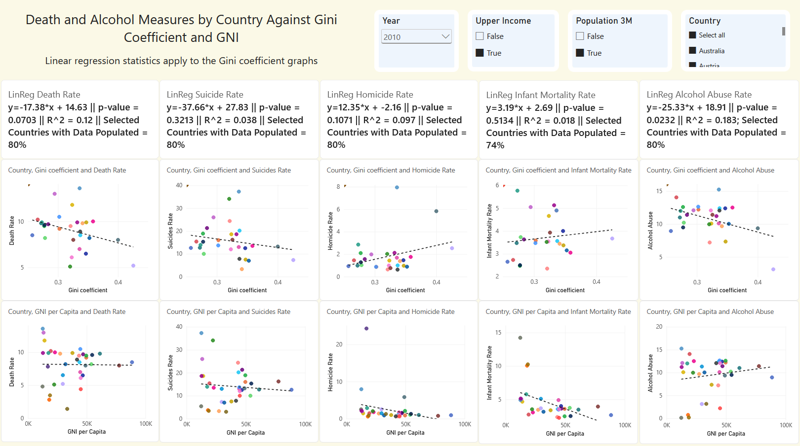  
 
     
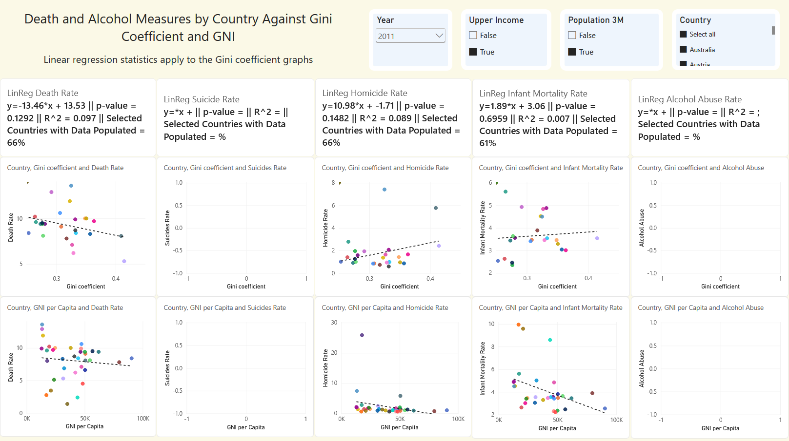  
 
     
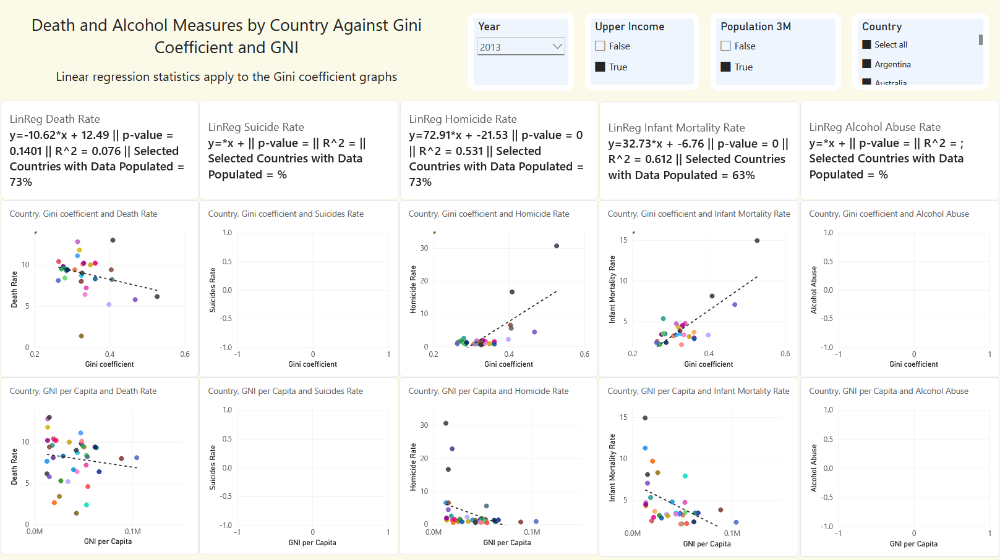  
 
     
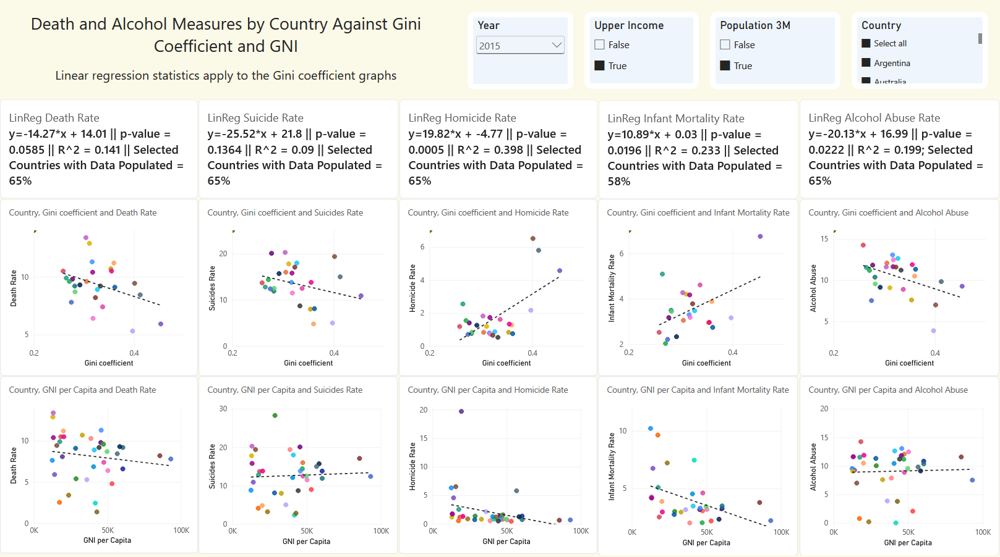  
 
     

When an outlier like Panama is included, the p-values can be very low, and the R^2 value very large.  The R^2 values for Homicide Rate and Infant Mortality Rate are 0.575 and 0.489, respectively, in 2016.  The Homicide Rate and Infant Mortality Rate for Panama are large and far to the right of the other values.

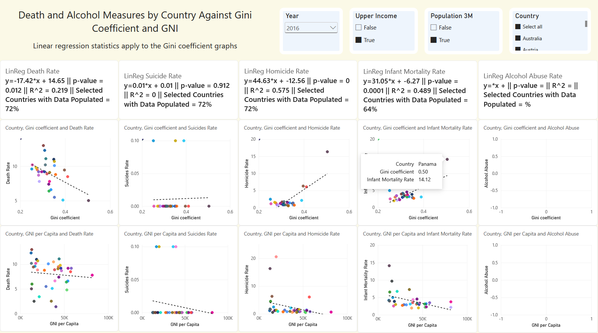  
 
     

When Panama is excluded, the p-values grow and the R^2 value decreases.  In the Homicide Rate graph, the p-value is still very small with Panama excluded, and the R^2 value is still fairly large.  In the Infant Mortality graph, the p-value balloons from 0.0001 to 0.958, and the R^2 value drops from 0.489 to 0.
 
     
One of the criticisms people have of "The Spirit Level" is that the United States is an outlier and it creates statistically significant results, when there would be no statistical significance if it were excluded.  The United States is a unique country.  I understand the debate.  Many of the findings in "The Spirit Level" are dependent on where the upper income threshold is set and which countries are included in the analysis.

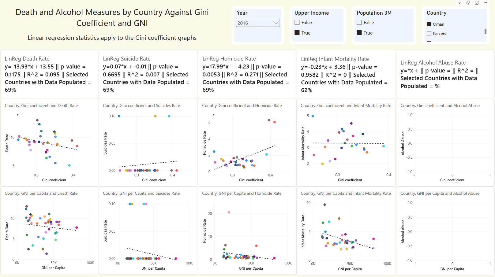  
 
     

