[Link to Power BI Report - Global Health and Inequality](https://app.powerbi.com/reportEmbed?reportId=672903bb-96fe-4342-9ed5-9c8da6129d6f&autoAuth=true&ctid=87f457b7-df9f-4c5a-a1fa-7eb5150a5541)
 

The Power BI report may require viewers to login to their Microsoft or Power BI account.  I've provided screenshots of each tab so viewers can review the dashboard without having to login.  The dashboard has additional interactive features.  
 
I plan to add more analysis to this page.
 

### Dashboard Overview

#### Data Sources
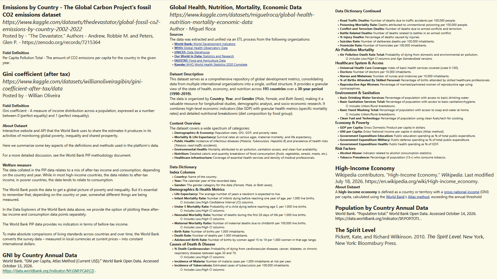  
 
     
  
 
     

#### Notes and Analysis
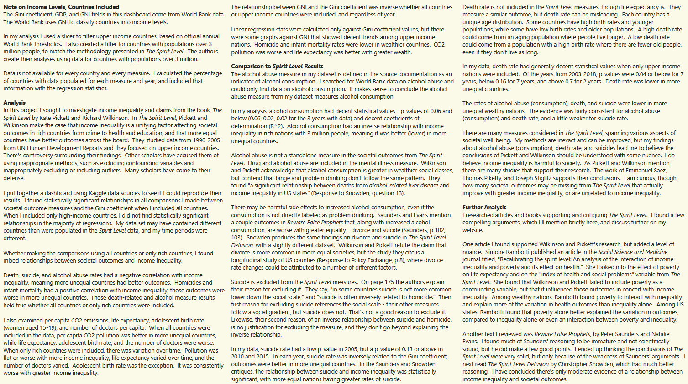  
 
     

### Societal Outcomes tab
#### Users can choose which parameters to view, which year, and which income levels.
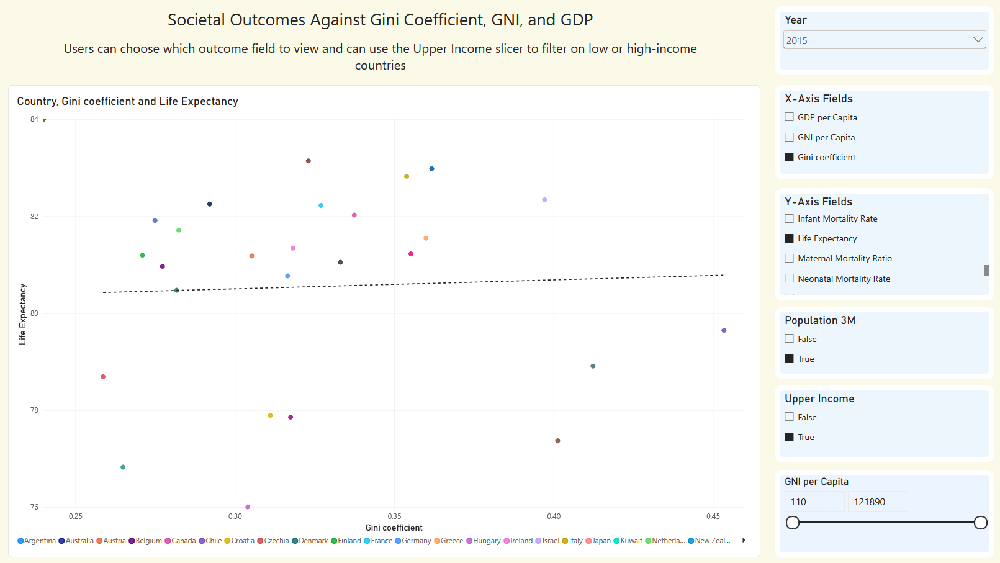  
 
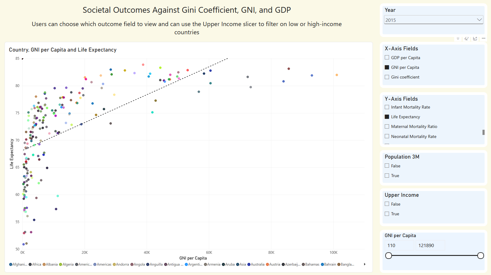  
     
 

### Statistical Results for All Countries
When all countries were included, the p-values for measures on the next two tabs (Death and Alcohol, Pollution and Life Expectancy) were under 0.06; only two measures had a p-value greater than 0.06 between 2003 and 2017, and those measures only had high p-values for 1 year each.
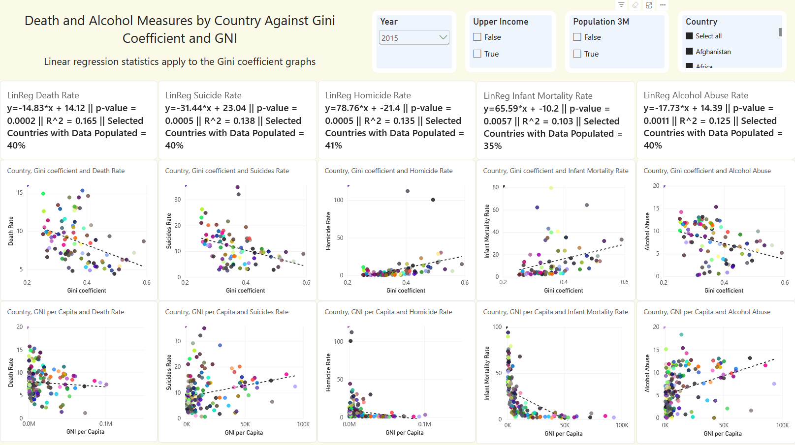  
 
     

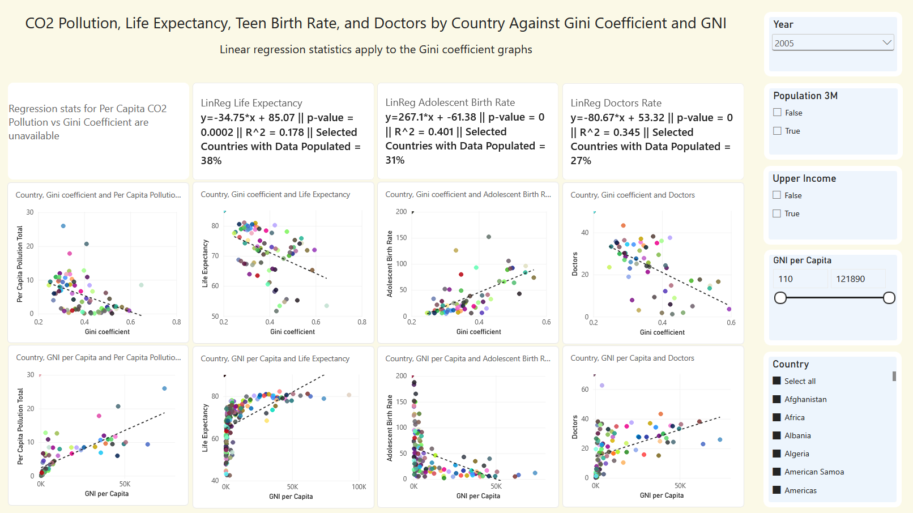  
 
     

### Gini Coefficient vs GNI
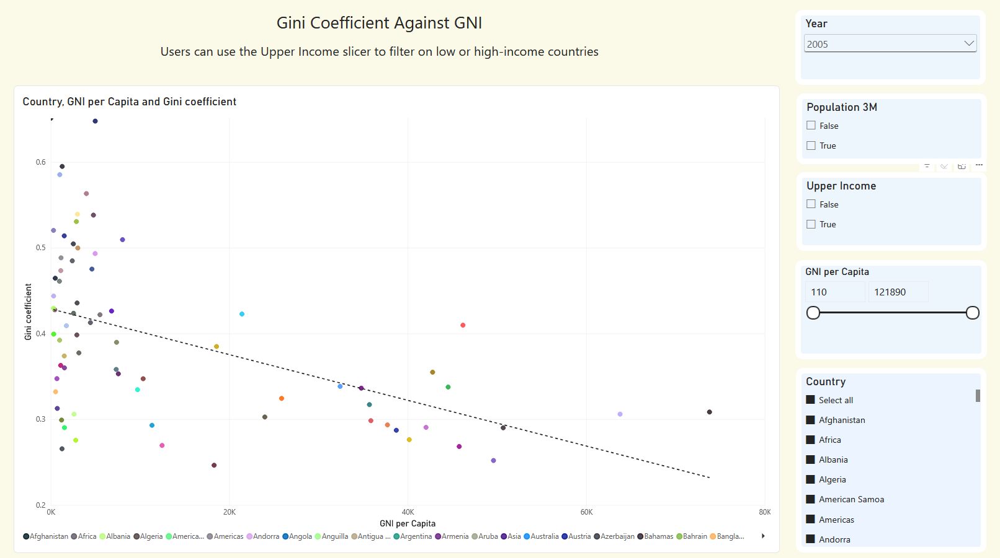  
 
     

### Relationships between measures and the gini coefficient change with income levels
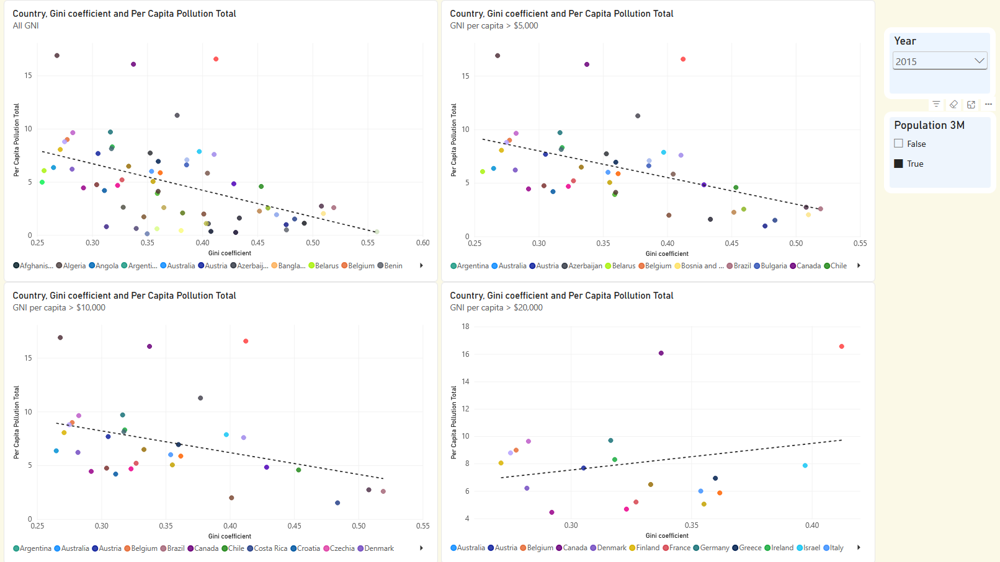  
 
     

### Statistical Results for Upper Income Countries
In "The Spirit Level," the authors focus on upper income countries with over 3 million people.  When only those countries are included, p-values are not consistent from year to year.  Most measures had high p-values for at least a few years.  Alcohol Abuse and Adolescent Birth Rate were the only exceptions.  Data for the alcohol abuse measure was only available every 5 years.  For 2005, the p-value was 0.062.  For 2010 and 2015, the p-values were both 0.02.  So, alcohol abuse had decent p-values for all years with data.  Adolescent birth rate had the most consistent and strong p-values.  The p-values for adolescent birth rate (births among women aged 15-19) were 0.05 or below every year.
 
 
Homicide, Infant Mortality, Life Expectancy, and Teenage Birth Rate (births among women aged 15-19) are measures included in the "Spirit Level" analysis that I also included in my dashboard.  I only found consistent, statistically significant results for Adolescent/Teenage Birth Rate.  The original study in "The Spirit Level" uses data from the years 1998-2004 for most of the measures.  Homicide data comes from the years 1990-2000.    

### Death and Alcohol Tab
In 2004, the results for Death Rate and Homicide Rate are pretty good.  There's convincing evidence of a relationship between the Gini coefficient and each of those measures.
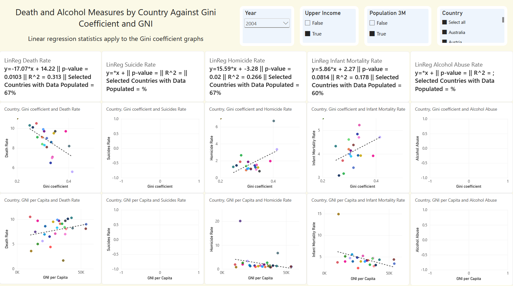  
 
     
In 2005, Death Rate, Suicide Rate, and Homicide Rate have low p-values.  The p-value for Alcohol Abuse Rate is decent, but not convincing of a relationship between Alcohol Abuse and the Gini coefficient.  The p-value for Infant Mortality Rate is large, indicating no relationship between Infant Mortality and the Gini coefficient.
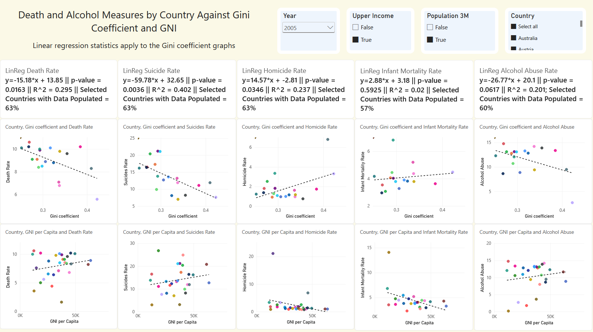  
 
     
In 2006, Death Rate has a low p-value again.  The other p-values do not indicate a relationship between the respective measures and the Gini coefficient.
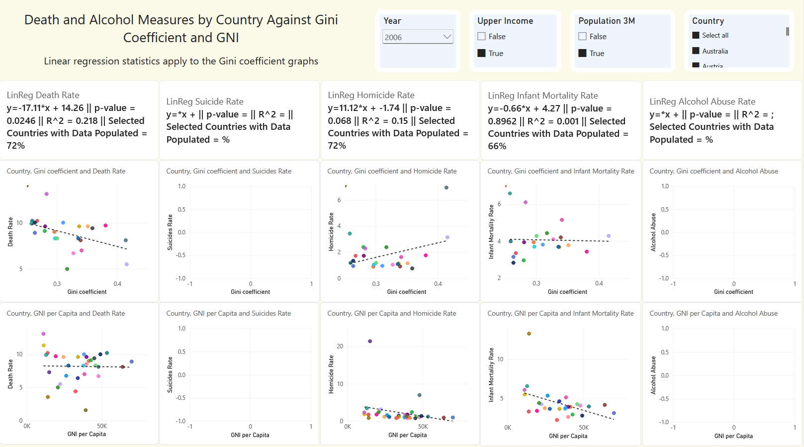  
 
     
In 2009, the p-value for Death Rate is ok, but not indicative of a relationship between Death Rate and the Gini coefficient.
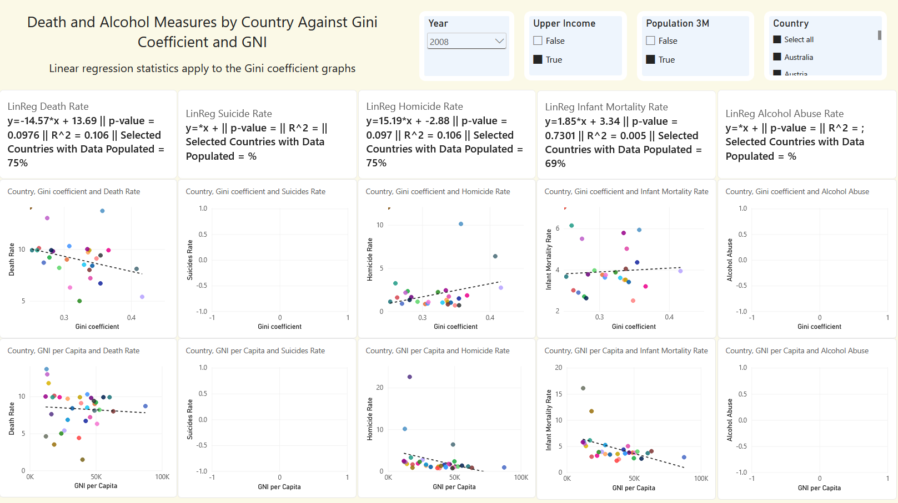  
 
     
In 2010, the only measure with a p-value indicating statistical significance is Alcohol Abuse Rate.  Four of the five measures had data for 80% of countries meeting the criteria for inclusion, and the other measure had data for 74% of countries.  Data is most complete for upper income countries in 2010.
 
 
Homicide Rate and Infant Mortality Rate are measures from "The Spirit Level" included on this tab.  They had high p-values indicating no statistical evidence of a relationship between them and the Gini coefficient.  The authors of "The Spirit Level" used a different data source and a different time frame than me.  I'm curious whether the results from their data source are consistent each year, or whether they focused on a period when the relationships between their selected measures and the Gini coefficient were stronger.

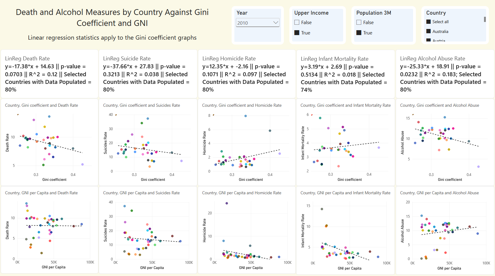  
 
     
There was evidence of a statistically significant relationship between Death Rate and the Gini coefficient in 2004 - 2006, but in other years the p-values are above 0.05 and there's no evidence of a relationship.  Likewise, the p-value for Suicide Rate was low in 2005, but not in 2010 or 2015.
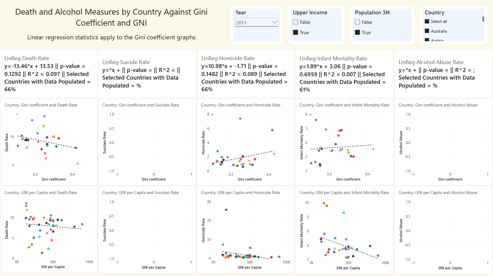  
 
     
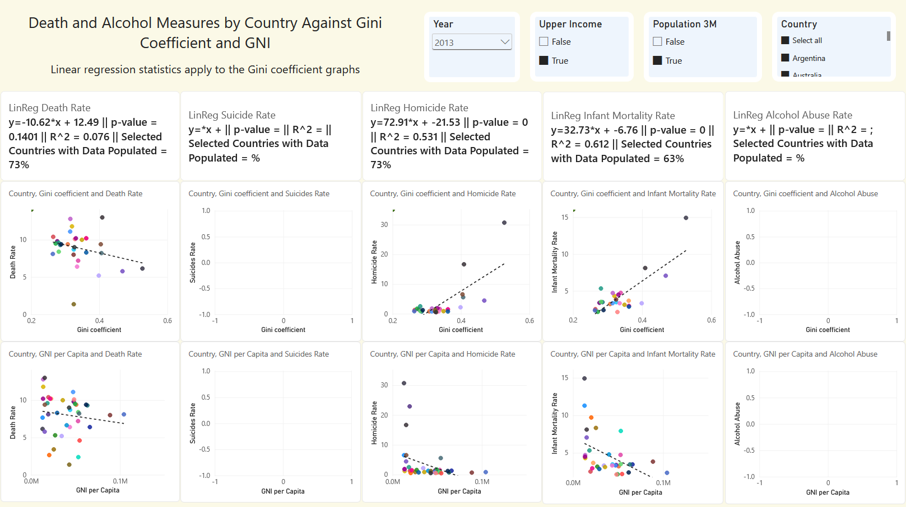  
 
     
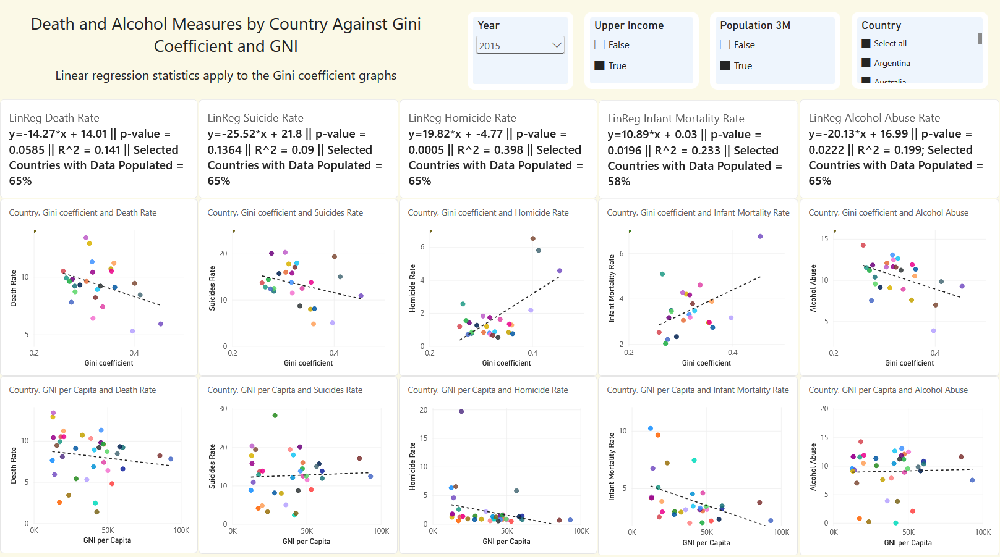  
 
     

When an outlier like Panama is included, the p-values can be very low, and the R^2 value very large.  The R^2 values for Homicide Rate and Infant Mortality Rate are 0.575 and 0.489, respectively, in 2016.  The Homicide and Infant Mortality rates for Panama are large and far to the right of the other values.

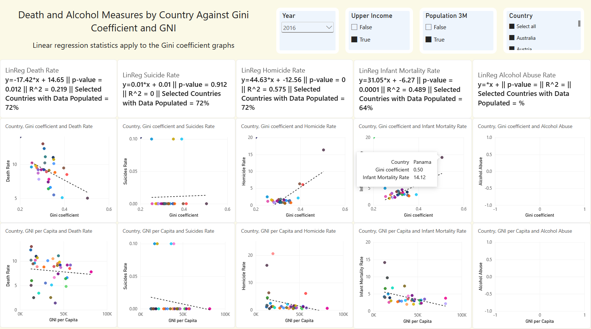  
 
     

When Panama is excluded, the p-values grow and the R^2 values decrease.  In the Homicide Rate graph, the p-value is still very small with Panama excluded, and the R^2 value is still fairly large.  In the Infant Mortality Rate graph, the p-value balloons from 0.0001 to 0.958, and the R^2 value drops from 0.489 to 0.
 
     
One of the criticisms people have of "The Spirit Level" is that the United States is an outlier and it creates statistically significant results, when there would be no statistical significance if it were excluded.  The United States is a unique country.  I understand the debate.  Many of the findings in "The Spirit Level" are dependent on where the upper income threshold is set and which countries are included in the analysis.

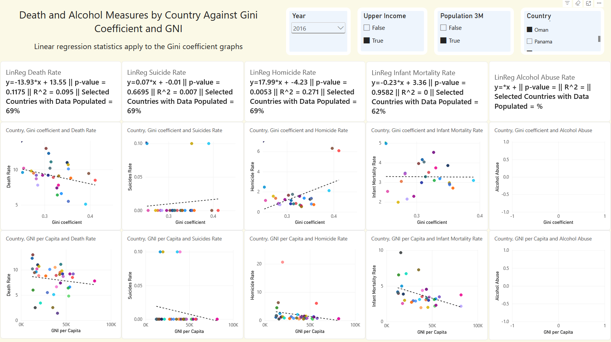  
 
     

### Pollution and Life Expectancy Tab
Adolescent Birth Rate shows a statistically significant relationship with the Gini coefficient each year.  The other measures do not show evidence of a relationship with the Gini coefficient.  Life Expectancy decreases as a function of the Gini coefficient some years, but increases in other years.  The same is true of the rate of Doctors.  CO2 Pollution increases or is flat each year, but there does not appear to be a strong relationship between CO2 Pollution and the Gini coefficient, based on the spread and scattering of values in the graphs.  Regression statistics were unavailable due to the nature of the connections between tables in the data model.  I might work on creating a separate data model in order to produce regression stats for CO2 Pollution.

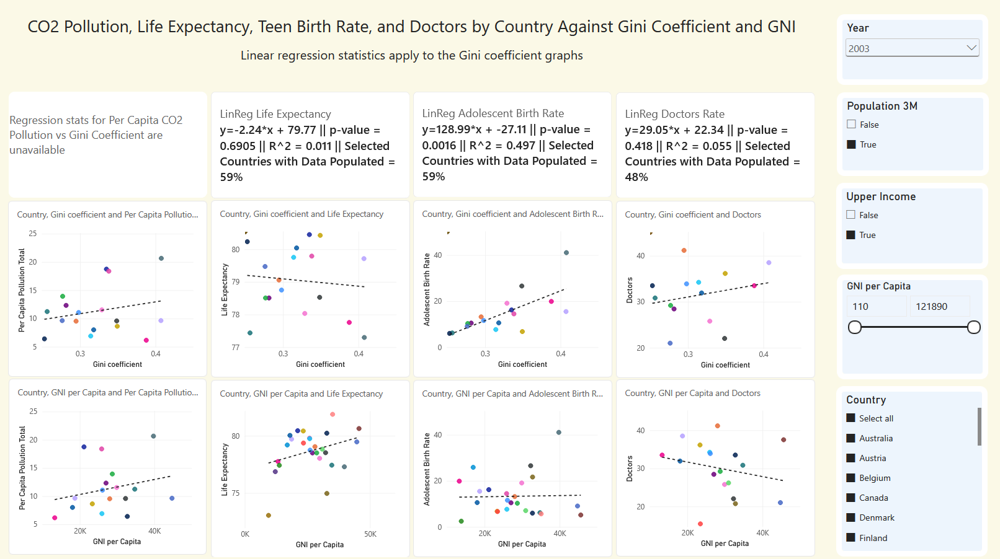  
 
     
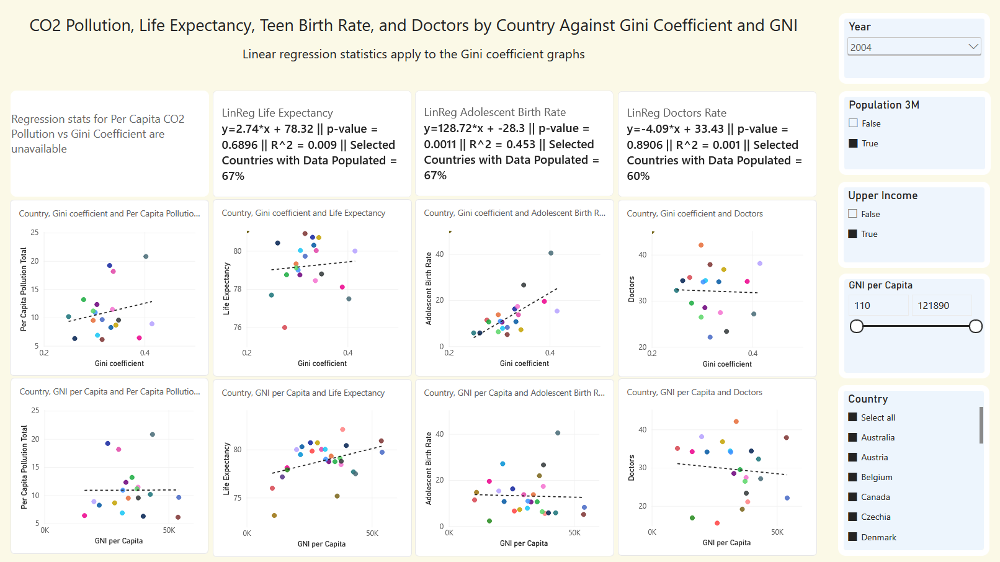  
 
     
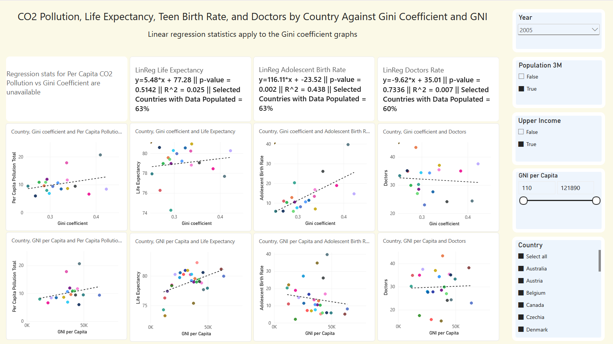  
 
     
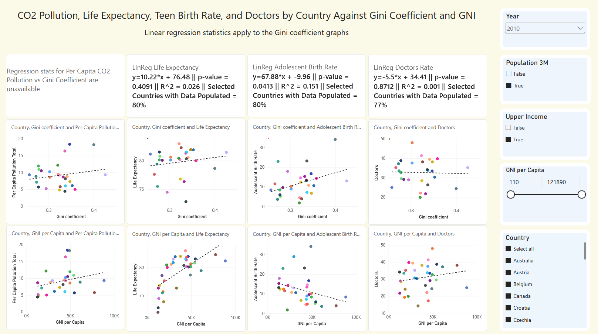  
 
     
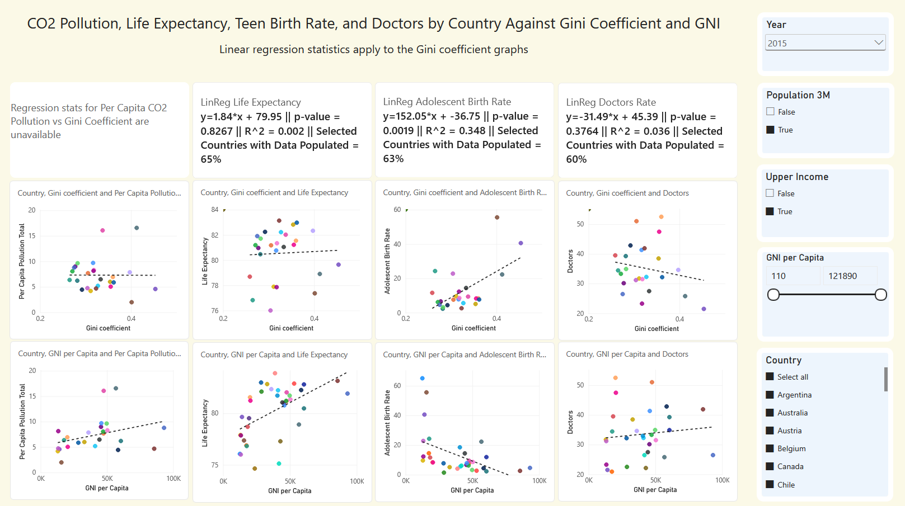  
 
     

### Further Analysis
I reviewed a few critiques of The Spirit Level - an article on the interaction between income inequality and poverty by Simone Rambotti, and two books that thoroughly reviewed the evidence presented in The Spirit Level.  Peter Saunders wrote a book called, _Beware False Prophets - Equality, the Good Society and The Spirit Level_, and Christopher Snowden wrote a book called _The Spirit Level Delusion - Fact-Checking the Left's New Theory of Everything_.

One article I found supported Wilkinson and Pickett's research, but added a level of nuance.  Simone Rambotti published an article in the _Social Science and Medicine_ journal titled, "Recalibrating the spirit level: An analysis of the interaction of income inequality and poverty and its effect on health."  She looked into the effect of poverty on life expectancy and on the "index of health and social problems" variable from The Spirit Level.  She found that Wilkinson and Pickett failed to include poverty as a confounding variable, but that it influenced those outcomes in concert with income inequality.  Among wealthy nations, Rambotti found poverty to interact with inequality and explain more of the variation in health outcomes than inequality alone.  Among US states, Rambotti found that poverty alone better explained the variation in outcomes, compared to inequality or even an interaction between poverty and inequality.

Next I reviewed _Beware False Prophets_.  The Saunders book presented poor evidence against Wilkinson and Pickett's claims, so I initially thought my dashboard was simply missing data and that the relationship between poor societal outcomes and inequality was strong.  Next I read the Snowden book, _The Spirit Level Delusion_, which presented much more sophisticated arguments, and **now conclude the evidence is only moderate that societal outcomes are related to inequality.**

Saunders frequently uses the same datasets as Wilkinson and Pickett.  Some of his criticisms are legitimate, but some seem immature and not scientifically sound.  He removes outliers to test whether relationships hold without single countries, which is reasonable, but he also removes whole groups of countries, like the Scandinavian countries and the Anglophone countries (US, UK, Australia, Canada, New Zealand, Ireland).  Saunders adds his own datasets to his analysis.  Sometimes they support Wilkinson and Pickett's claims and sometimes they don't.

Snowden's critique is much more sophisticated and legitimate.  He uses his own dataset with additional countries.  He includes Hungary, Slovenia, the Czech Republic, Hong Kong, and South Korea in his dataset.  They are absent from _The Spirit Level_, but they all meet the upper income threshold by 2006.  Slovenia has only 2 million people.  The rest of the countries meet the 3 million population threshold.  By adding Korea and Hong Kong, Snowden is able to paint a more complete picture of Asian outcomes.  The four Asian nations have very different levels of inequality, but often similar outcomes.

Some of the Snowden's additional countries are excluded from _The Spirit Level_ due to missing data.  Snowden includes the countries by adding in data from other sources where it is lacking in the World Bank or other dataset.

For many of the measures used in _The Spirit Level_, Snowden produces graphs and regressions that show there's no relationship between income inequality and the outcome.  He also produces a few graphs that show a contrary relationship - better outcomes among more unequal nations.

I created a summary of Wilkinson and Pickett's international outcomes measures.  Only 4 of the 14 measures withstood the criticisms of Saunders and Snowden.

**Summary of Wilkinson and Pickett's Statistical Claims - International Data Only**

**Homicide - No evidence of a relationship**
	- The relationship should hold with 1 country (US) removed and it does not
	- In "Response to Policy Exchange," Wilkinson and Pickett claim that 50 studies show a link between inequality and violence.  There may indeed be a link, but I don't consider the evidence to be sufficient in their data.
	- Snowden shows there's no evidence of a relationship.  He includes Hong Kong and R^2 = 0.0897.  When the USA is removed, the R^2 value is 0.0068.

**Childhood Conflict - Relationship is valid**
	- Snowden does not address this measure

**Women's status - No evidence of a relationship**
	- Snowden addresses this issue on his blog using a UN index of gender empowerment
	- https://spiritleveldelusion.blogspot.com/2010/05/womens-empowerment.html
	- There's no evidence of a relationship when the Czech Republic, Slovenia, Hungary, and South Korea are included

**Foreign Aid - No evidence of a relationship**
	- Relationship is valid at the government spending level, but Saunders and Snowden have a valid counterpoint
	- Some less equal nations donate more on an individual bases to charity
	- When charity is factored in, total % GNI given to developing nations is not related to inequality
	
**Trust - No evidence of a relationship**
	- When per capita GDP is included in a multivariate analysis, inequality ceases to have statistical significance.
	- 1 question should not be used to determine whether a societal outcome is related to inequality
	- Saunders and Snowden - membership in a community organization is positively correlated with inequality
	- Community membership is evidence of trust.  Results from the World Values Survey question on trust can be explained by per capita GDP.  Together, the evidence shows there's no relationship between overall trust and inequality.

**Infant mortality - Relationship is valid**
	- Saunders agrees.  He uses multiple tests, including one with his own dataset of 39 countries, and finds the relationship to be robust.
	- Snowden includes Hungary and Hong Kong.  Hungary could rightly be left out of the data, and the statistical relationship would likely be valid.

**Life expectancy - No evidence of a relationship** specific to inequality
	- Life expectancy is related to national income, poverty, inequality, culture (see Japan, Hong Kong, and Singapore), and other factors
	- For this conclusion, I considered Rambotti's analysis, Saunders' critique, Snowden's critique, and my own data

**Obesity - adults - No evidence of a relationship**
	- Wilkinson and Pickett include only Japan out of all Asian countries.  Snowden rightly includes Singapore, Korea, and Hong Kong.  His results show there's no relationship between obesity and inequality.  The Asian countries provide a good snapshot of the issue.  They all have low levels of obesity, but very different levels of inequality.  Cultural similarities seem to be more powerful than inequality.
	
**Obesity - children - No evidence of a relationship**, see above

**Literacy and numeracy - No evidence of a relationship**
	- When Hong Kong is included, there's no longer evidence of a trend (Snowden, Figure 9.2, p 156).

**Innovation and creativity - No evidence of a relationship**
	- The histogram of standardized residuals should be normally distributed, but it is clearly not.  In this case, Saunders' rejection of the statistical validity of the data is warranted.

**Teenage births - Relationship is valid**
	- Saunders removes both the Scandinavian and Anglo countries to try to argue that the relationship doesn't exist
	- Saunders and Snowden both show that divorce rates are greater in more equal countries.  Snowden shows that single parent households are unrelated to inequality.
	- Teenage births are related to inequality, but other factors of family relationships are better in more unequal countries.  Family connectedness is unrelated to inequality.

**Imprisonment rates - Relationship is valid**
	- Snowden shows that crime rates including homicide and theft are unrelated to inequality
	- The imprisonment rate correlation with inequality is due to government policies
	
**Social mobility - No evidence of a relationship**
	- Too few countries included in _Spirit Level_ analysis
	- In "Response to Policy Exchange," the authors mention other studies on social mobility and claim the relationship has strengthened since _The Spirit Level_ was published.
	

4/14 measures are valid

Childhood conflict, infant mortality, teenage birth rates, and imprisonment rates show strong evidence of being related to income inequality.

With each outcome that's related to income inequality, there are other outcomes that seem to counterbalance the relationship.  Infant mortality is lower in more equal nations, but life expectancy and obesity show little relationship with inequality.  Teenage births are related to inequality, but so are divorce rates, with more unequal countries having lower divorce rates.  Imprisonment rates are related to inequality, but crime rates are not.  Imprisonment rates seem to be related to government policies that are common among unequal countries, and different government policies that are common among more equal countries.

Snowden explains several outcomes that are unrelated to inequality - smoking prevalence, obesity, life expectancy, most diseases, happiness, children living in single parent households, unemployment, the "quality of life" index created by the Economist Intelligence Unit, homicide, theft, overall crime rates, and total percentage of GNI donated to developing countries (including individual charity).  Snowden also mentions a few outcomes that are better among more unequal nations - membership in a community organization, divorce rates, suicide, and individual charity.

I conclude that societal outcomes are very complicated and influenced by many factors.  On the international level, a few factors are hugely significant.  Culture, government policy, per capita wealth, and poverty levels play a major role.  Inequality does seem to be related to outcomes in subtle ways, but the evidence that Wilkinson and Pickett produce is misleading.  The criticism that they don't use a complete dataset is legitimate.  Hong Kong, Singapore, and Korea should be included in most or all of their graphs.  Singapore is part of their dataset, but they exclude it from a few regressions.  The US plays an outsize role in many of their regressions.  The regressions should hold when the US is removed, and they often do not.  **International data does not provide evidence of a strong relationship between societal outcomes and inequality.**

### Disclaimer:

I used AI to research and produce some of the code used in this report. I did not use AI to edit or write any of the analysis.
